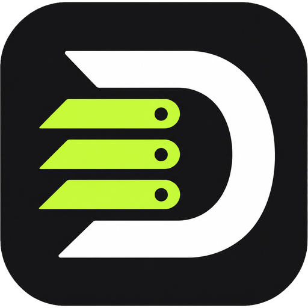
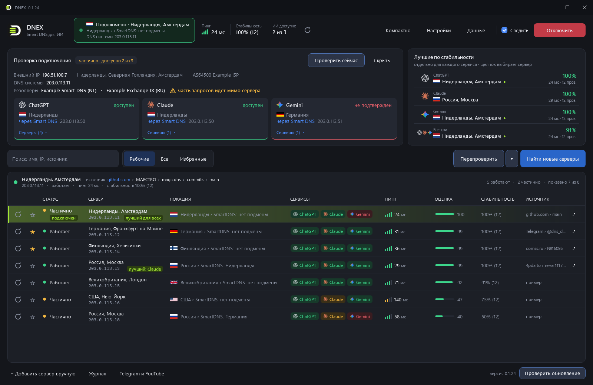
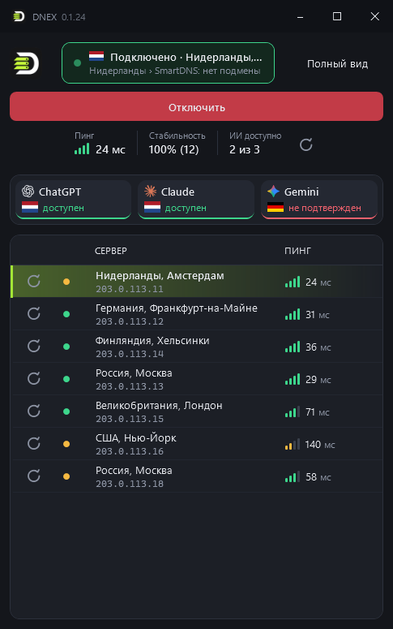

<p align="center">
  
</p>

# DNEX: переключатель DNS для доступа к ИИ

Приложение для Windows (WPF, .NET 8). Собирает DNS-серверы из открытых источников, проверяет, работают ли они с ChatGPT, Claude и Gemini, и переключает DNS системы в один клик. Поддерживаются обычный DNS и DoH. Исходные настройки сохраняются, откат делается одной кнопкой.

> **Важно.** Обход географических ограничений ИИ-сервисов нарушает их условия использования, и аккаунт могут заблокировать. Вы используете программу на свой риск.

## Скриншоты

Главное окно, рабочий размер 1600×1040:



Компактный вид, 485×775:



Данные на снимках выдуманные: IP-адреса из диапазона документации `203.0.113.0/24`, названия серверов условные.

## Возможности

- **Поиск серверов.** Парсер стартовых страниц: сайты, статьи, форумы 4PDA, Telegram-каналы (`t.me/s/…`), raw-файлы GitHub. Дополнительно ищет через DuckDuckGo и Bing. Переходит по ссылкам с ключевыми словами на заданную глубину, листает темы форумов и каналы, читает UTF-8 и windows-1251.
- **Источник у каждого сервера.** Колонка «Источник» и кнопка «Открыть ↗» показывают страницу, где найден сервер.
- **Проверка сервисов.** Для ChatGPT, Claude и Gemini программа получает ответ сервера и пинг, сравнивает ответ с эталонным DoH (подменяет ли сервер адреса сервисов), делает HTTPS-запрос к API через IP сервера с проверкой сертификата и ищет признаки «регион не поддерживается». Ведется статистика стабильности и оценка.
- **Локация сервера.** Колонка «Локация» показывает страну и город DNS-сервера с флагом и страну адреса Smart DNS, например «Россия › SmartDNS: Нидерланды». Страны определяются по двум IP-базам: ipinfo.io и ipwho.is. Если базы расходятся, показывается ⚠.
- **Страна ИИ-адреса.** В блоке «Проверка подключения» видно, через какую страну идет доступ к каждому сервису. Если сервис открывается напрямую, геолокация не показывается.
- **Откуда вас видят ИИ.** Некоторые Smart DNS отдают адрес прокси в одной стране, а трафик выпускают через другую. Строка «ИИ видят вас из» показывает настоящую страну и город выхода для ChatGPT, Claude и Gemini. Узнается это через служебную страницу Cloudflare `/cdn-cgi/trace`, ту же, что видит сам сервис. В таблице страна выхода показана у каждого сервера.
- **Поиск и фильтр** по имени, IP, DoH, источнику, сервисам и статусу.
- **Переключение.** Обычный DNS или DoH (Windows 11). Двойной щелчок по строке применяет сервер.
- **Сторож.** Пока подключение активно, DNS проверяется через заданный интервал (по умолчанию 60 секунд). Если сети нет совсем (сон, загрузка, смена Wi-Fi), сторож ждет. Если DNS сбросила другая программа, подключение возвращается. После трех неудач подряд сторож переключается на следующий сервер по стабильности и отключается, только если замены нет.
- **Автозапуск с подключением.** Галочка «Запускать вместе с Windows» создает задание в Планировщике: DNEX стартует при входе в систему, сразу в трее и с правами администратора. Права Windows спросит один раз, при включении. После загрузки программа ждет сеть до полутора минут и проверяет DNS. Если подключение было включено, а DNS сбросился, он возвращается сам, без окон и запросов.
- **Перепроверка на выбор.** Обычная, глубокая (три прохода, случайный сбой не портит оценку) или только по одному сервису. Порядок «Сначала лучшие для Claude» (или ChatGPT, Gemini) выстраивает таблицу по одному сервису.
- **Избранное.** Звездочка в строке. Избранные стоят сразу под подключенным сервером и при равной стабильности выбираются сторожем первыми.
- **Трей.** Программа остается в трее, если закрыть окно крестиком (это включается в настройках). Меню показывает статус подключения, пинг, стабильность и доступность трех сервисов. Пункт «Переключить на лучший» подключает самый надежный из рабочих серверов. Доступность сервисов в трее обновляется при запуске, при подключении и затем через заданный интервал (по умолчанию 5 минут).
- **Статистика подключения.** В шапке справа от карточки подключения: пинг, стабильность и число доступных ИИ-сервисов.
- **Компактный вид.** Окно 485×775: кнопка подключения, статистика по центру и список рабочих серверов с локацией и пингом.
- **Значок связи.** Рядом с пингом четыре столбика: их число и цвет зависят от значения (до 50 мс горят все четыре зеленые, до 100 мс три, до 200 мс два желтые, дольше один красный). Столбики плавно растут при обновлении.
- **Подключенный сервер первым.** В таблице он всегда наверху, какой бы колонкой ни была отсортирована. Отмечен плашкой «подключен» и лаймовым градиентом строки.
- **Обновление одного сервера.** Кнопка слева в каждой строке проверяет только этот сервер, значок крутится в его строке. Такая же кнопка есть рядом со статистикой подключения.
- **Пинг каждые 10 минут.** Пинг всех серверов обновляется сам: таблица, шапка, строка под таблицей и трей. Интервал меняется в настройках (от 1 до 60 минут).
- **Логотипы ИИ-сервисов.** Логотипы ChatGPT, Claude и Gemini в блоке проверки и в списке сервисов.
- **Журнал.** Записи окрашены по уровню: информация, успех, предупреждение, ошибка. Есть фильтр, очистка, копирование. Можно выбрать несколько строк и скопировать их (Ctrl+C, двойной щелчок, контекстное меню).
- **Ручное добавление.** Сервер можно добавить по IP или DoH-адресу. Новый сервер сразу проверяется.
- **Защита от зависаний.** Поиск ограничивает время на страницу (30 секунд), страница без ответа пропускается. Если поиск долго ничего не получает, журнал показывает, какие адреса в работе. Сайты для взрослых, казино и ставки поиск не открывает никогда.
- **Telegram и YouTube.** Кнопка «Telegram и YouTube» внизу окна и пункты в трее включают две сторонние программы с открытым кодом:
  - [TG WS Proxy](https://github.com/Flowseal/tg-ws-proxy) (Flowseal, MIT): локальный прокси, ускоряет Telegram Desktop. Кнопка «Подключить Telegram» сама передает Telegram адрес прокси. Если у вас уже запущена своя копия прокси, DNEX ее не выключает.
  - [zapret-discord-youtube](https://github.com/Flowseal/zapret-discord-youtube) (bol-van и Flowseal, MIT, внутри WinDivert): обход замедления YouTube и Discord. Стратегия выбирается из списка, есть обход для игр. Нужны права администратора. Ставится в `C:\ProgramData\DNEX\zapret`, потому что в пути с кириллицей zapret не работает.

  DNEX скачивает их официальные релизы с GitHub, сверяет SHA-256, которую отдает GitHub, и без совпадения ничего не ставит. Обновления видны в том же окне. Включенные программы поднимаются при запуске DNEX и выключаются при выходе из нее. Антивирусы иногда ругаются на WinDivert и на упакованный exe прокси: это ложные срабатывания, о них пишут сами авторы.
- **Обновление из программы.** Версия и кнопка «Проверить обновление» внизу окна. Программа спрашивает GitHub API, при отказе смотрит ленту релизов и страницу последнего релиза. Кнопка «Обновить» в окне новой версии скачивает архив из релиза, сверяет его контрольную сумму SHA-256 и ставит новый DNEX.exe на место старого. Новая версия заработает после перезапуска: кнопка «Перезапустить» делает его сразу, подключение DNS при этом сохраняется. Если сумма не совпала или нет прав на папку программы, ничего не меняется и окно предлагает страницу релиза.
- **Выход с активным подключением.** По умолчанию выбран вариант «Нет»: выйти, оставив DNS как есть. Отключение происходит только после явного выбора «Да».

## Android

> **Версия для Android нестабильна.** Пользуйтесь ей на свой страх и риск. Новые сборки APK в ближайших релизах выходить не будут: Android-версию планируется переделать полностью, чтобы она работала стабильно. Последняя сборка, DNEX-0.1.0.apk, лежит в релизе 0.1.18.

Компактный экран перенесен как на ПК: подключение, статистика, список серверов, подключенный сервер первым. Режим DNS для ИИ работает через VPN-сервис Android, другой трафик телефона не меняется. Трей, автозапуск и откат DNS на уровне системы на Android не переносились.

<p align="center">
  
  
  
</p>

Снимки Android выдуманные: адреса серверов из диапазонов документации (203.0.113.x, 198.51.100.x, 192.0.2.x).

## Требования

- Windows 10 или 11, 64-бит.
- Для сборки нужен [.NET 8 SDK](https://dotnet.microsoft.com/download/dotnet/8.0).
- Для запуска готового файла нужен .NET 8 Runtime.

Права администратора не нужны. UAC запрашивается при смене или откате DNS и один раз при включении автозапуска. Из автозапуска программа стартует сразу с правами администратора, поэтому после загрузки DNS возвращается без запросов.

## Сборка

```
build.cmd                                   # сборка Release и запуск из bin
```

`build.cmd` не начнет сборку, если DNEX уже запущен. Закройте окно штатно: при аварийном завершении во время активного подключения DNS останется переключенным.

Готовый файл для распространения:

```
dotnet publish -c Release -r win-x64 --self-contained false -p:PublishSingleFile=true
```

Результат: `bin\Release\net8.0-windows\win-x64\publish\DNEX.exe`.

## Тесты

```
dotnet test tests/DNEX.Tests
```

Тесты покрывают разбор DNS-ответов (границы пакета, чужой id, NXDOMAIN, обрезанный пакет), определение публичных адресов и допустимость DoH-адресов. Папка `tests` в сборку программы не входит.

## Настройки и данные

Кнопка «Данные» открывает папку `%AppData%\DNEX`. Другую папку можно задать переменной окружения `DNEX_DATA_DIR`, например для отдельной копии программы или для тестов:

- `settings.json`: источники (`sources`), глубина и лимиты обхода, поисковые запросы (`discoveryQueries`), ключевые слова ссылок, сервисы и признаки блокировки (`targets`), исключенные IP, `hostCookies`.
- `servers.json`: список серверов, результаты проверок, страны и адреса прокси.
- `flags\`: кэш флагов стран.
- `active.json`: текущее подключение. Нужен, чтобы отключиться даже после аварийного завершения.
- `dns-backup.json`: исходные настройки DNS, которые вернутся при отключении.
- `ui.json`: компактный или полный вид.
- `junk.json`: удаленные серверы. 14 дней их не добавляют снова.
- `error.log`: необработанные ошибки.

Настройки меняются в окне «Настройки». Там же есть интервал проверки сервисов в трее (1–60 минут) и интервал сторожа (15–600 секунд). Там же задается интервал обновления пинга (по умолчанию 10 минут). Если правите `settings.json` вручную, нажмите «Перечитать настройки».

### Сайты с авторизацией (4PDA)

Если без входа видна не вся информация, добавьте Cookie из браузера, в котором вы авторизованы:

```json
"hostCookies": { "4pda.to": "member_id=...; pass_hash=...; ..." }
```

Cookie берутся в DevTools: Network, любой запрос к 4pda.to, заголовок Cookie. Это данные входа в ваш аккаунт, не передавайте файл другим людям. Cookie в `settings.json` шифруются ключом вашей учетной записи Windows (DPAPI) и отправляются только на указанный домен и только по HTTPS.

## Что уходит в сеть

- Источники, которые вы настроили, и страницы, на которые они ведут. Поиск: DuckDuckGo HTML и Bing.
- Эталонный DoH (по умолчанию `1.1.1.1` и `dns.google`) для сравнения ответов.
- Проверка сервисов: API ChatGPT, Claude и Gemini через адреса серверов. В трее это происходит по расписанию, даже если подключения нет.
- `ipinfo.io`: внешний IP для блока «До / После», локация DNS-серверов и адресов прокси.
- `ipwho.is` и `country.is`: еще две базы локации для сверки.
- `chatgpt.com/cdn-cgi/trace` и `claude.ai/cdn-cgi/trace`: страна, с которой сервисы видят подключение.
- `dnscheck.tools`: тест утечки DNS при подключении, отключении и по кнопке.
- GitHub: релизы TG WS Proxy и zapret-discord-youtube, только когда вы их включаете или обновляете.
- GitHub: проверка новой версии, скачивание обновления (только по кнопке «Обновить») и поиск списков серверов в репозиториях.
- `flagcdn.com`: флаги стран, один раз на страну.

Отправляются только публичные адреса DNS-серверов и сервисов. Личные данные программа не передает, кроме того, что вы сами указали в `hostCookies`.

## Безопасность

- Программа работает без прав администратора. UAC запрашивается только при смене и откате DNS. Исключение: автозапуск через Планировщик, там программа стартует с правами администратора, чтобы вернуть DNS без запроса. Ссылки и в этом случае открываются в обычном браузере без прав администратора. PowerShell вызывается по полному системному пути, скрипт передается через `-EncodedCommand` без временных `.ps1`. IP-адреса проверяются, DoH-адрес экранируется.
- DNS меняется только у физических адаптеров (`Get-NetAdapter -Physical`). VPN-туннели и виртуальные сети не затрагиваются.
- Запись о подключении сохраняется до смены DNS. Если смена не удалась, DNS возвращается к исходным значениям. Если вы отказали в UAC, запись удаляется.
- Отключение находит адаптеры по GUID (номер интерфейса может измениться), сбрасывает адреса DNEX, удаляет только свои записи DoH и проверяет результат. После подключения проверяется доступ в интернет. Если его нет, настройки откатываются автоматически.
- Парсер не обращается к localhost, роутеру и адресам локальной сети, даже если на них ведет ссылка со стороннего сайта. Адрес проверяется в момент соединения, поэтому подмена адреса через DNS (DNS rebinding) проверку не обходит. Переадресации обрабатываются вручную.
- Регулярные выражения работают с таймаутом, размер страниц и ответов ограничен, DNS-ответы разбираются с проверкой границ.
- HTTPS-проверка серверов проверяет сертификат сервиса: прокси с поддельным сертификатом не считается рабочим. Отзыв сертификатов (OCSP и CRL) не проверяется. Это осознанное решение.
- Работает только один экземпляр программы. Значения в `settings.json` проверяются при загрузке.

## Ограничения

- Обычный DNS (порт 53) может перехватывать провайдер. Предпочитайте серверы с DoH.
- Если в сети есть IPv6-DNS от роутера, он может обходить выбранный сервер.
- Признаки блокировки сервисов определяются эвристически. Их можно поправить в `targets`.
- Локация определяется по IP-базам, а не по физическому месту. DoH-серверы за anycast-адресами могут показывать ближайший узел. Если базы расходятся, показывается ⚠.
- Города приходят из ipinfo на английском. Русские названия есть примерно для 80 часто встречающихся стран.
- Встроенный каталог серверов (`Catalog.cs`) устаревает: адреса сервисов меняются.
- Проверка работает только по IPv4. IPv6-адреса серверов и сервисов не используются.

## Структура проекта

| Путь | Содержимое |
|---|---|
| `MainWindow.xaml(.cs)` | окно, список серверов, сценарии подключения, трей |
| `SettingsWindow.xaml(.cs)` | окно настроек |
| `App.xaml(.cs)` | стили, палитра, точка входа, один экземпляр |
| `Tray.cs` | меню трея и значки статуса |
| `ClosePrompt.cs` | вопрос при выходе с активным подключением |
| `Services/DnsSwitcher.cs` | смена и откат DNS через PowerShell |
| `Services/DnsWire.cs` | DNS-клиент для UDP и DoH без сторонних библиотек |
| `Services/ServerChecker.cs` | проверка сервера и сервисов |
| `Services/ConnectionProbe.cs` | снимок «до / после»: внешний IP, DNS, доступ сервисов |
| `Services/SourceParser.cs` | парсер источников и поиск |
| `Services/GeoLocation.cs` | локация по IP и флаги стран |
| `Services/Catalog.cs` | встроенный каталог серверов |
| `Services/Storage.cs` | файлы в `%AppData%\DNEX`, шифрование Cookie |
| `Models/` | сервер, настройки, проверяемые сервисы, записи журнала (`LogEntry.cs`) |
| `Controls/PingBars.cs` | значок связи для пинга |
| `Services/ServiceAccess.cs` | критерий доступа к ИИ-сервису по ответу API |
| `Services/AutoStart.cs` | автозапуск через Планировщик заданий |
| `Services/EgressTrace.cs` | страна, с которой ИИ-сервисы видят подключение |
| `Services/UpdateChecker.cs` | проверка новой версии |
| `Services/Updater.cs` | скачивание, проверка и установка обновления |
| `Services/Tools/` | TG WS Proxy и zapret: релизы с GitHub, установка, запуск, обновление |
| `ToolsWindow.cs` | окно «Telegram и YouTube» |
| `DnexDialog.cs` | окна-сообщения в стиле программы |
| `Services/LeakTest.cs` | тест утечки DNS |
| `tests/DNEX.Tests` | тесты |
| `build.cmd` | сборка и запуск |
| `reset-dns.cmd`, `reset-dns.ps1` | аварийный сброс DNS, который выставила DNEX |

`reset-dns.cmd` возвращает исходные DNS тем физическим адаптерам, которые меняла DNEX, по резервной копии `dns-backup.json`. Если копии нет, адаптер переходит на автоматические адреса (DHCP). Адаптеры, которых DNEX не трогала, скрипт не меняет. Если DNEX ничего не меняла, скрипт ничего не делает. Используйте его, если программа не запускается, а DNS остался переключенным.

## Лицензия

PolyForm Noncommercial 1.0.0. Программу можно использовать, копировать и менять в некоммерческих целях. Продавать программу или ее сборки, а также брать за них деньги нельзя. Полный текст в файле [LICENSE](LICENSE).
