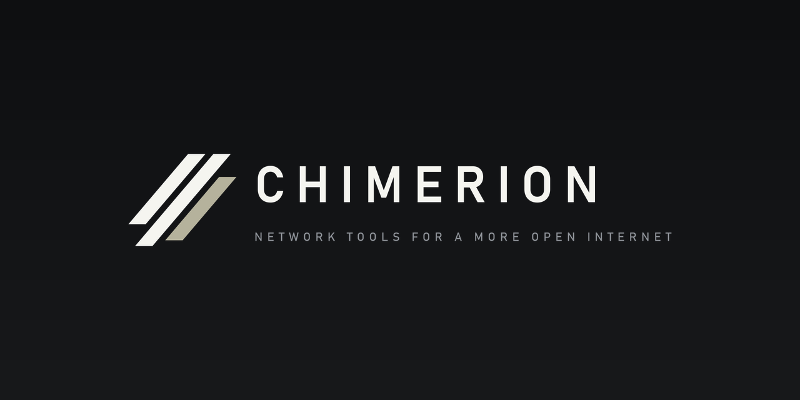
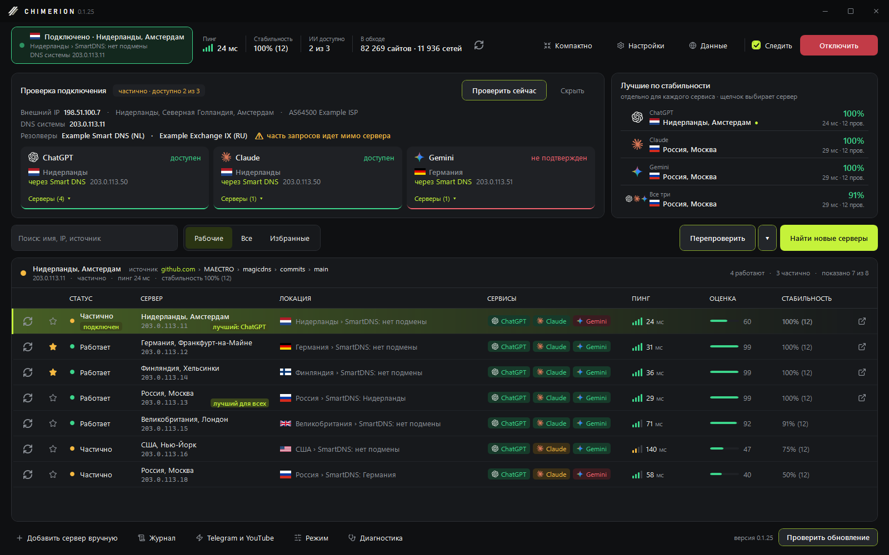
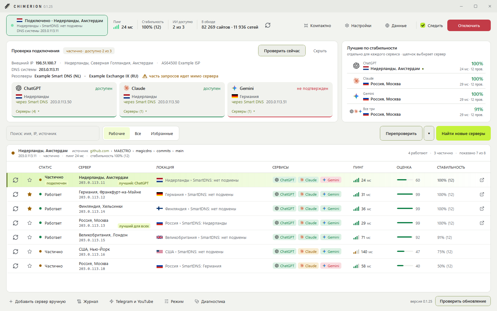
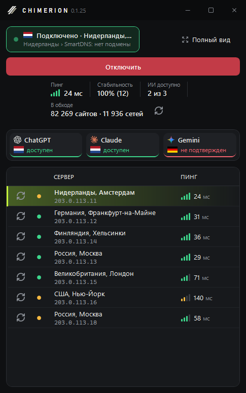
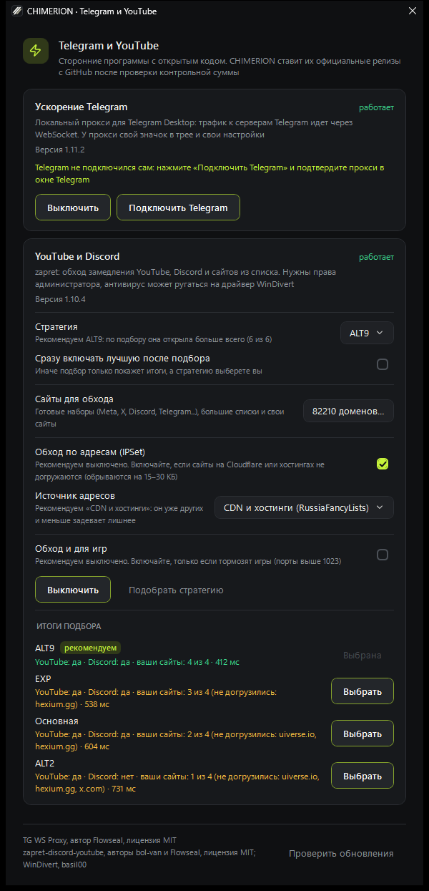
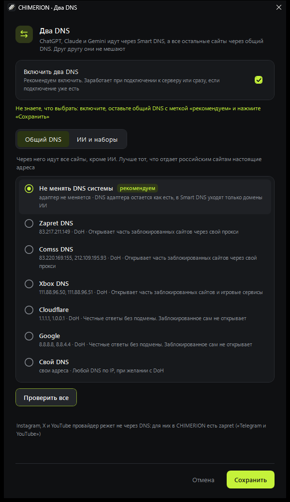
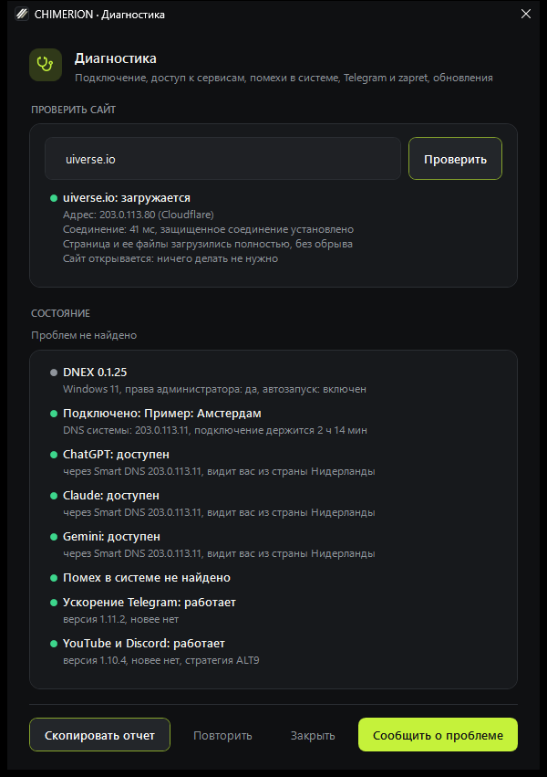
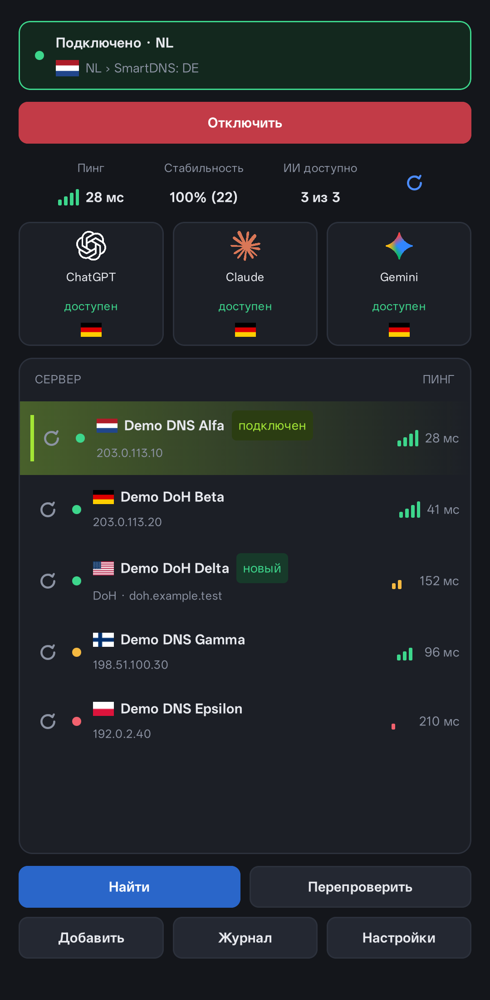
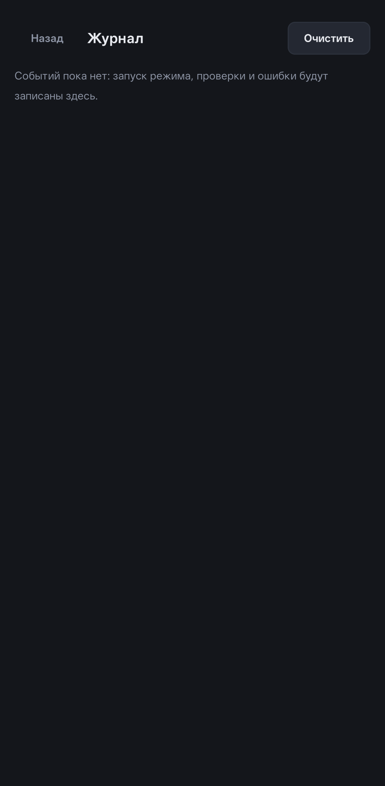
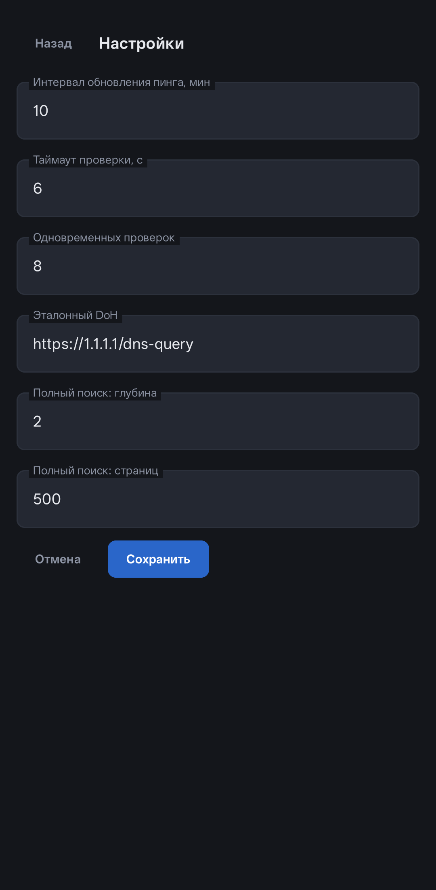

<p align="center">
  
</p>

# CHIMERION

Программа для Windows, с которой ChatGPT, Claude и Gemini открываются из России без VPN. Она сама находит Smart DNS, проверяет, какие из них правда пускают к нейросетям, и подключает лучший в один клик. Рядом живут обход замедления YouTube и Discord, ускорение Telegram и проверка сайтов, которые не открываются.

> **CHIMERION раньше назывался DNEX.** Это тот же проект. Если у вас стоит DNEX, она обновится сама, настройки и список серверов останутся.

> **Важно.** Обход региональных ограничений нарушает условия использования ИИ-сервисов, аккаунт могут заблокировать. Пользуйтесь программой на свой риск.

## Скачать

Последняя версия лежит на странице [релизов](https://github.com/under2ker/chimerion/releases/latest): архив `CHIMERION-x.y.z-win-x64.zip`, внутри один файл `CHIMERION.exe`. Устанавливать ничего не нужно, нужен только [.NET 8 Desktop Runtime](https://dotnet.microsoft.com/download/dotnet/8.0) и Windows 10 или 11 (64-бит). Дальше программа обновляется сама, по кнопке.

## Как это выглядит



Светлая тема и компактный вид:

<p>
  
  
</p>

«Telegram и YouTube», «Два DNS» и «Диагностика»:

<p>
  
  
  
</p>

На снимках выдуманные данные: адреса из диапазона документации `203.0.113.0/24`, названия серверов условные.

## Что умеет

**Smart DNS для нейросетей.** Программа собирает DNS-серверы с сайтов, форумов 4PDA, Telegram-каналов и GitHub, а при первом запуске сразу получает мой проверенный список. Каждый сервер проверяется по-настоящему: подменяет ли он адреса ChatGPT, Claude и Gemini, отвечает ли API, не пишет ли сервис «регион не поддерживается», из какой страны вас видят. По этим проверкам считаются стабильность и оценка, лучшие серверы стоят наверху. Подключение делается одной кнопкой, исходные настройки сохраняются, отключение возвращает все как было.

**Два DNS.** Нейросети идут через Smart DNS, а весь остальной интернет через обычный DNS. Банки, госуслуги и российские сайты при этом не замечают подмены. Общий DNS можно оставить свой или выбрать из готовых, программа покажет, какой лучше открывает заблокированное и не ломает российские сайты.

**Telegram и YouTube.** Две открытые программы, которые CHIMERION ставит, запускает и обновляет сама:
[TG WS Proxy](https://github.com/Flowseal/tg-ws-proxy) ускоряет Telegram Desktop, а [zapret-discord-youtube](https://github.com/Flowseal/zapret-discord-youtube) снимает замедление YouTube, Discord и других сайтов. Для zapret есть 38 готовых наборов сайтов по разделам, большой список заблокированного от [Re:filter](https://github.com/1andrevich/Re-filter-lists) и ваши собственные сайты. Стратегию обхода программа подбирает сама: по очереди пробует каждую на YouTube, Discord и ваших сайтах и предлагает лучшую.

**Диагностика.** Одна кнопка собирает все проверки в отчет: подключение, доступ к сервисам, страну выхода, помехи вроде VPN или «безопасного DNS» в браузере, состояние zapret и прокси. Найденное часто можно исправить прямо из отчета. Там же проверяется любой сайт, который не открывается: программа скажет, виноват DNS, провайдер или сам сайт, и что поможет.

**Сторож и трей.** Пока вы подключены, программа следит за DNS. Если его сбросила другая программа, подключение возвращается, если сервер перестал отвечать, она переключается на следующий надежный. Можно запускать вместе с Windows: тогда CHIMERION стартует в трее и сам возвращает подключение. При выходе можно оставить работать DNS, обход и ускорение Telegram.

**Удобство.** Светлая и темная темы, свои цвета интерфейса, русский и английский языки, компактный вид, избранные серверы, журнал. Там, где нужно что-то выбрать, есть метка «рекомендуем» и кнопки «Рекомендуемые» и «Выбрать все».

**Обновления.** Программа проверяет новую версию на GitHub и ставит ее по кнопке. Архив собирается на GitHub Actions и подписан моим ключом, без верной подписи обновление не ставится. Если новая версия не запустится, CHIMERION сама вернет прежнюю.

## Android

> **Версия для Android нестабильна.** Новых сборок пока не будет: Android-версию я переделаю полностью. Последняя сборка, `DNEX-0.1.0.apk`, лежит в релизе 0.1.18.

<p align="center">
  
  
  
</p>

## Права и безопасность

Права администратора программе не нужны. Windows спрашивает разрешение, только когда меняется или возвращается DNS, и один раз при включении автозапуска. Из автозапуска программа сразу стартует с правами администратора, чтобы вернуть DNS без вопросов. Для zapret права нужны всегда, так устроен его драйвер.

- DNS меняется только у физических адаптеров. VPN и виртуальные сети программа не трогает.
- Перед сменой DNS сохраняется резервная копия. Если после подключения пропал интернет, настройки откатываются сами.
- Поиск серверов не заходит на адреса локальной сети и на роутер, даже если на них ведет чужая ссылка. Сайты для взрослых, казино и ставки он не открывает.
- Сторонние программы ставятся только из официальных релизов на GitHub и только при совпадении контрольной суммы. Антивирусы иногда ругаются на WinDivert внутри zapret и на упакованный exe прокси. Авторы этих программ пишут, что это ложные срабатывания.
- Если программа не запускается, а DNS остался переключенным, запустите `reset-dns.cmd`. Он вернет адаптерам исходные DNS по резервной копии и уберет правила «Двух DNS».

## Что уходит в сеть

- Источники серверов, которые вы настроили, страницы, на которые они ведут, и поиск через DuckDuckGo и Bing.
- Проверка серверов: эталонный DoH (`1.1.1.1`, `dns.google`), API ChatGPT, Claude и Gemini, служебные страницы `chatgpt.com/cdn-cgi/trace` и `claude.ai/cdn-cgi/trace`, тест утечки `dnscheck.tools`.
- Локация адресов: `ipinfo.io`, `ipwho.is`, `country.is`, флаги стран с `flagcdn.com`.
- GitHub: новая версия, стартовый список серверов и наборы сайтов (не чаще раза в 12 часов и раз в сутки), релизы TG WS Proxy и zapret, когда вы их включаете или обновляете, большие списки Re:filter, eduard256 и RussiaFancyLists, если вы их выбрали.
- YouTube и Discord: короткие запросы, пока подбирается стратегия zapret.
- GitHub Issues: только если вы сами нажали «Сообщить о проблеме». Внешний IP, адреса локальной сети, имя пользователя и почту программа из отчета убирает.

Личные данные программа никуда не отправляет. Исключение одно: Cookie, которые вы сами добавили для сайтов с авторизацией (см. ниже).

## Настройки и данные

Кнопка «Данные» открывает папку `%AppData%\DNEX`. Имя папки осталось от прежнего названия, так обновление не теряет ваши настройки. zapret ставится в `C:\ProgramData\DNEX\zapret`: в пути с кириллицей он не работает.

- `settings.json`: источники, поисковые запросы, проверяемые сервисы, цвета, тема и язык.
- `servers.json`: серверы и результаты проверок. `junk.json`: удаленные серверы, 14 дней их не добавляют снова.
- `active.json` и `dns-backup.json`: текущее подключение и исходные DNS, чтобы отключиться даже после сбоя.
- `error.log`: ошибки, если что-то пошло не так.

Если без входа на 4PDA видна не вся информация, в `settings.json` можно добавить Cookie из браузера:

```json
"hostCookies": { "4pda.to": "member_id=...; pass_hash=...; ..." }
```

Cookie шифруются ключом вашей учетной записи Windows и уходят только на указанный сайт по HTTPS. Это данные входа в аккаунт, не передавайте этот файл другим.

## Ограничения

- Обычный DNS (порт 53) провайдер может перехватить. Если есть выбор, берите серверы с DoH.
- IPv6-DNS от роутера может обходить выбранный сервер. Для серверов без IPv6 программа на время подключения выключает IPv6 на адаптере.
- Признаки блокировки сервисов определяются эвристикой, а локация по IP-базам, а не по физическому месту.
- Сайты, которые провайдер режет по адресу или через DPI, DNS не откроет. Для них есть zapret, а для сервисов, которые сами закрылись для России, нужен Smart DNS или VPN.

## Сборка

Нужен [.NET 8 SDK](https://dotnet.microsoft.com/download/dotnet/8.0).

```
build.cmd                                     # сборка Release и запуск
dotnet test tests/CHIMERION.Tests             # тесты
dotnet publish CHIMERION.csproj -c Release -r win-x64 --self-contained false -p:PublishSingleFile=true
```

Перед сборкой закройте программу штатно: если оборвать ее во время подключения, DNS останется переключенным.

<details>
<summary>Структура проекта</summary>

| Путь | Что внутри |
|---|---|
| `MainWindow.xaml(.cs)` | главное окно, таблица серверов, подключение, трей |
| `SettingsWindow.xaml(.cs)`, `SettingsColors.cs` | настройки, цвета и тема |
| `ToolsWindow.cs`, `Services/Tools/` | Telegram и YouTube: установка, запуск и обновление TG WS Proxy и zapret |
| `SplitDnsWindow.cs`, `Services/SplitDns.cs` | «Два DNS» |
| `DiagnosticsWindow.cs`, `Services/Diagnostics.cs`, `Services/SiteCheck.cs` | диагностика и проверка сайта |
| `Services/DnsSwitcher.cs`, `Services/DnsWire.cs` | смена и откат DNS, DNS-клиент для UDP и DoH |
| `Services/ServerChecker.cs`, `Services/ConnectionProbe.cs` | проверка серверов и подключения |
| `Services/SourceParser.cs` | поиск серверов по источникам |
| `Services/Updater.cs`, `Services/UpdateChecker.cs` | обновление из программы |
| `Services/ThemeColors.cs`, `Services/Loc.cs` | темы, свои цвета, английский язык |
| `Controls/` | знак CHIMERION, иконки, значок связи, график истории, плавная прокрутка |
| `catalog/` | подписанный список серверов и наборы сайтов для обхода |
| `docs/brand/` | логотип, иконки и баннер |
| `tests/CHIMERION.Tests` | тесты |
| `reset-dns.cmd` | аварийный сброс DNS |

</details>

## Благодарности

Спасибо авторам [TG WS Proxy](https://github.com/Flowseal/tg-ws-proxy) и [zapret-discord-youtube](https://github.com/Flowseal/zapret-discord-youtube) (Flowseal, bol-van, WinDivert от basil00), списков [v2fly/domain-list-community](https://github.com/v2fly/domain-list-community), [Re:filter](https://github.com/1andrevich/Re-filter-lists), [eduard256/russia-blocked-ips](https://github.com/eduard256/russia-blocked-ips) и [RussiaFancyLists](https://github.com/Noktomezo/RussiaFancyLists). Иконки интерфейса из [Lucide](https://lucide.dev) (ISC), логотипы ChatGPT, Claude и Gemini из [Simple Icons](https://simpleicons.org) (CC0), они принадлежат своим владельцам. Полоса прогресса сделана по мотивам элемента satyamchaudharydev с [uiverse.io](https://uiverse.io) (MIT).

## Лицензия

PolyForm Noncommercial 1.0.0. Программу можно использовать, копировать и менять в некоммерческих целях. Продавать ее или брать деньги за сборки нельзя. Полный текст в [LICENSE](LICENSE).

under2ker
